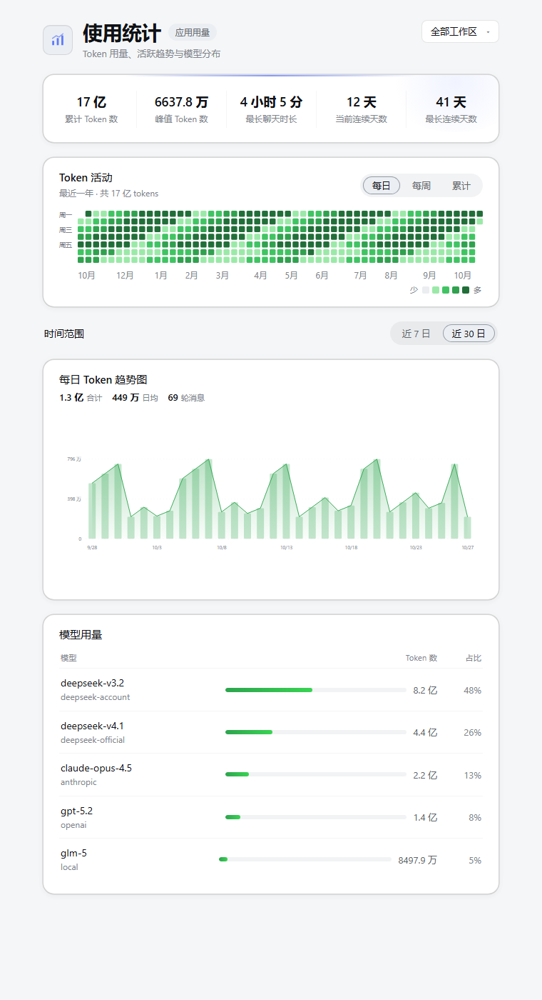
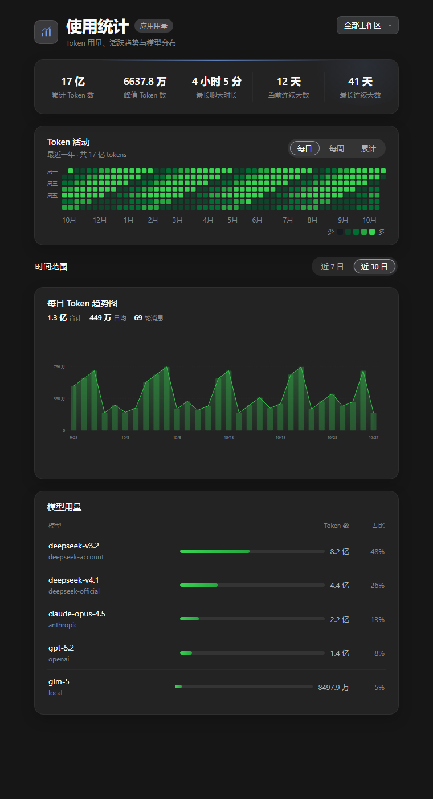
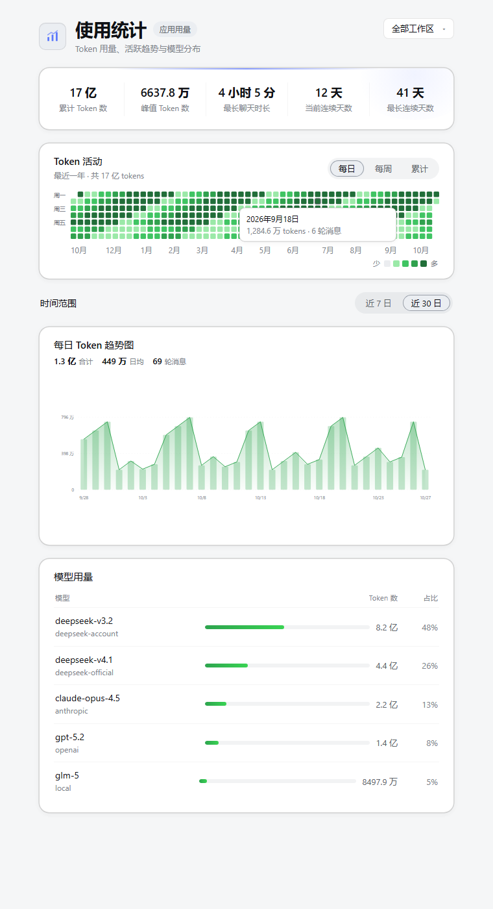

# dsh-usage-stats

**DeepSeek Harness 使用统计插件** · Usage statistics for [DeepSeek Harness](https://github.com/deepseek-ai/deepseek-harness)

在 DSH 的「设置 → 使用统计」里查看 Token 用量、活跃热力图、每日趋势与模型分布。所有数据都在本机计算，**不联网、不上报**。



<details>
<summary>深色主题 / 热力图悬停</summary>





</details>

> 仓库名是 `dsh-token`，插件包名是 **`dsh-usage-stats`**。安装时使用的是包名，不是仓库名。

---

## 功能

- **5 个关键指标**：累计 Token、峰值 Token、最长聊天时长、当前连续天数、最长连续天数
- **Token 活动热力图**：GitHub 风格绿色色阶，支持 `每日 / 每周 / 累计`，悬停查看当天 tokens 与轮消息
- **每日 Token 趋势图**：`近 7 日 / 近 30 日` 切换，含区间合计、日均与轮消息摘要
- **模型用量**：按 provider + model 统计 Token 与占比
- **工作区筛选**：全部工作区或任一工作区单独查看
- **增量缓存 + 后台预热**：首次折叠后落盘，之后打开即秒开；当前会话实时递增
- **中英双语**、深/浅色主题跟随 DSH、窄窗口自适应

## 环境要求

| 项目 | 要求 |
|---|---|
| DeepSeek Harness | `0.2.x`（已在 `0.2.0-rc.2` 与 `0.2.1-rc.3` 验证） |
| Node.js | `>= 22.15`（原生 `zlib` zstd；仅兼容读取路径需要） |
| 平台 | Windows / macOS / Linux |

## 安装

### 方式一：DSH 桌面端插件页（推荐）

1. 打开 DSH → **设置 → 插件**
2. 选择安装插件，填入下面任一形式：

   | 形式 | 例子 |
   |---|---|
   | GitHub 简写 | `github:niuxh1/dsh-token` |
   | 仓库 URL | `https://github.com/niuxh1/dsh-token` |
   | 仓库 URL（.git） | `https://github.com/niuxh1/dsh-token.git` |

3. 安装完成后按提示重启 DSH
4. 打开 **设置 → 使用统计**

插件管理器会自动把它登记到当前 profile 的 `dsh.profile.bundles` 并安装依赖。

> 仓库名是 `dsh-token`，**包名是 `dsh-usage-stats`**——登记 bundle 时用的是包名。

### 方式二：命令行（web / 自建 profile）

```bash
cd ~/.dsh/profiles/<profile-name>
pnpm add github:niuxh1/dsh-token
```

然后把包名加入该 profile 的 `package.json`：

```json
{
  "dependencies": {
    "dsh-usage-stats": "github:niuxh1/dsh-token"
  },
  "dsh": {
    "profile": {
      "bundles": ["...", "dsh-usage-stats"]
    }
  }
}
```

重启对应的 DSH profile：

```bash
dsh --profile <profile-name> --port <port>
```

### 方式三：从源码链接（开发/离线）

```bash
git clone https://github.com/niuxh1/dsh-token.git
cd dsh-token
npm run build          # 生成 lib/client.js；仓库已提交构建产物，可跳过

cd ~/.dsh/profiles/<profile-name>
pnpm add link:<本仓库绝对路径>
# 再把 "dsh-usage-stats" 加入 package.json 的 dsh.profile.bundles
```

Windows 上也可以用目录联接代替 `pnpm add`：

```bat
mklink /J "%USERPROFILE%\.dsh\profiles\desktop\node_modules\dsh-usage-stats" "C:\path\to\dsh-token"
```

> `desktop` profile 由 Electron 管理。改动 `package.json` / `node_modules` 后需要重启 DSH。

## 验证安装

- 设置里出现 **使用统计**，五个指标、热力图、趋势图和模型列表都有数据
- 可选诊断接口（需要浏览器登录 cookie）：

```bash
curl -b "<cookie>" http://127.0.0.1:<port>/api/usage-stats/diagnostics
```

返回 `listed / folded / failures / fallback / cached` 等字段；`failures: 0` 表示所有会话都已成功读取。
首次打开会先显示「正在读取历史会话…（done/total）」，预热完成后自动刷新为完整数字。

## 指标口径

| 指标 | 定义 |
|---|---|
| 累计 Token 数 | Σ `usage.totalTokens`（同时记录 input / output / cacheRead / cacheWrite） |
| 峰值 Token 数 | 按**本地日历日**分组后的单日最大值，附峰值日期 |
| 最长聊天时长 | 单会话内 Σ(`step/end − step/start`) 的最大值；无 step 时退化为 Σ turn 时长；两者都没有记 0 |
| 当前连续天数 | 从今天回溯，连续有 token 的天数；今天还没用量则从昨天起算 |
| 最长连续天数 | 历史上最长连续有 token 的天数 |
| 轮消息 | `user/message` 中 `source.kind === "user"` 的条数（注入的 time-context 等不计） |
| 模型用量 | 按 `assistant/message.source.{provider, model}` 分组 Σ tokens |

日界按宿主本地时区 00:00；数字 ≥1 亿显示「亿」、≥1 万显示「万」。

## 隐私与数据

- **只读本机**：数据来自 DSH 会话日志，通过 `ctx.sessionQuery` 读取；不发送任何网络请求
- **本地缓存**：`~/.dsh/storages/usage-stats/aggregates.v1.json`（可随时删除重建）
- **无遥测**：不收集用户、会话标题、工作区路径或模型内容
- **兼容读取**：当 DSH 持久化层拒绝「未知事件类型」的日志时，插件会改用本机 `node:zlib` 读取该会话的原始 zstd 日志；这是唯一绕过 `sessionQuery` 的路径，仍完全在本机进行

## 性能

- 首扫：后台并发 3 个 `readSession`，页面显示骨架与进度
- 之后：封存会话命中持久缓存；缓存前比对日志 `eventCount/lastSeq` 与文件指纹，日志变长自动重算
- 实时：订阅 `session/event` 的 `assistant/message`，增量即时进内存
- 快照 10 秒 TTL，`refresh` 端点强制重算

清缓存：删除 `~/.dsh/storages/usage-stats/aggregates.v1.json`，刷新页面即可重建。

## 排错

| 现象 | 处理 |
|---|---|
| 设置里没有「使用统计」 | 确认 `dsh.profile.bundles` 含 `dsh-usage-stats`，重启 DSH |
| 页面一直显示「正在读取历史会话」 | 查看 DSH 日志中的 `[dsh-usage-stats]` 告警；确认 `sessionQuery` 已加载 |
| 数字偏小 | 删除缓存文件后刷新；检查 `diagnostics` 的 `failures` |
| 只有部分工作区 | 工作区下拉选择「全部工作区」 |
| 安装后报 peer 版本不兼容 | 升级 DSH 到 `0.2.x`，或改用插件页安装以获取兼容版本 |

## 开发

```bash
npm test                 # node:test 单元测试
npm run build            # 由 src/client/*.js 生成 lib/client.js
npm pack --dry-run       # 检查发布包内容
```

无第三方依赖。客户端 bundle 是手写的 `window.__ModuleLoader__` 格式，源码片段共享同一个 factory 作用域，不能使用 `import` / `export`。

目录：

```
lib/index.js        宿主入口：RPC 通道 + 服务装配
lib/client.js       浏览器 bundle（由 src/client/*.js 生成，已提交）
src/host/           会话折叠、快照聚合、缓存、sessionQuery 编排
src/client/         页面、图表、样式片段
scripts/build-client.mjs
test/               node:test 单元测试
```

## License

[MIT](LICENSE) © 2026 Xuanhao Niu
